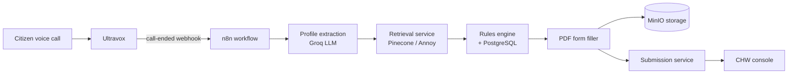

<div align="center">

# ZELIA

**Zero-Literacy Eligibility & Livelihood Intelligence Assistant**

A voice-first platform that helps Community Health Workers connect low-literacy households in India with the government welfare schemes they qualify for — from a spoken conversation to a filled application form.


[Overview](#overview) · [Architecture](#architecture) · [Quick start](#quick-start) · [Services](#services) · [Repository layout](#repository-layout) · [Testing](#testing) · [Documentation](#documentation)

</div>

---

## Overview

Millions of eligible citizens never claim welfare benefits because discovering schemes and completing forms assumes the ability to read and write. ZELIA removes that barrier:

| Capability | Description |
|---|---|
| **Voice intake** | A citizen speaks in their own language; Ultravox handles the conversation and transcript. |
| **Profile extraction** | An LLM (Groq) converts the transcript into a structured household profile — age, income, marital status, state, and more. |
| **Scheme discovery** | Hybrid retrieval (Pinecone, with an Annoy fallback) shortlists relevant schemes from a curated government dataset. |
| **Eligibility check** | A deterministic rules engine and SQL filters confirm which schemes the household actually qualifies for. |
| **Form filling** | The matching government PDF template is filled automatically and stored in MinIO. |
| **CHW review** | Submissions are routed to a Community Health Worker console for verification, correction, and follow-up. |

**Languages:** Tamil · Hindi · Kannada · Telugu · Malayalam · English (translation via Sarvam AI)

---

## Architecture



<details>
<summary><b>Pipeline stages in detail</b></summary>

1. **Ultravox webhook** — receives the completed call transcript.
2. **Extract profile** — LLM produces a normalized household profile; identifiers are hashed before storage.
3. **RAG hybrid search** — the retrieval service returns candidate scheme IDs.
4. **Eligibility (SQL + rules)** — schemes are filtered by state and deterministic criteria; each result carries its `pdf_template_key`.
5. **Fetch template & generate PDF** — the template is overlaid with profile fields and an appended data summary page.
6. **Upload & submit** — the filled form is stored in MinIO and a submission is created for CHW review.

The canonical workflow is [`zeliaintegration_v28b_fresh.json`](zeliaintegration_v28b_fresh.json). See [docs/ZELIA_FREE_V1_WORKING_SUMMARY.md](docs/ZELIA_FREE_V1_WORKING_SUMMARY.md) for the full contract of each stage.

</details>

---

## Quick start

### Prerequisites

- Docker Desktop (or Docker Engine + Compose v2), 8 GB RAM, ~20 GB disk
- Node.js 20+ (for the desktop frontend)
- API keys: Ultravox, Groq, Sarvam AI, Pinecone (optional — Annoy is used as fallback)

### 1. Clone and configure

```bash
git clone https://github.com/aswathiir/ZELIA.git
cd ZELIA
cp .env.example .env   # then fill in your API keys and passwords
```

### 2. Start the backend stack

```bash
docker compose up -d --build
```

### 3. Initialise the database

```bash
python scripts/run_migrations.py
python scripts/seed_database.py
```

### 4. Import the n8n workflow

Open n8n at <http://localhost:5678>, sign in with the credentials from your `.env`, and import [`zeliaintegration_v28b_fresh.json`](zeliaintegration_v28b_fresh.json).

### 5. Run the CHW desktop frontend

```bash
cd frontend/zelia-core-desktop/frontend
npm install
npm run dev            # http://localhost:5173
```

<details>
<summary><b>Verify the installation</b></summary>

```bash
python scripts/verify_stack.py
bash scripts/smoke_test_free_v1.sh
```

Windows users can run the equivalent PowerShell scripts, e.g. `scripts/health_check.ps1`.

</details>

---

## Services

All services are defined in [`docker-compose.yml`](docker-compose.yml) and share the `zelia-network`.

<details open>
<summary><b>Core application services</b></summary>

| Service | Host port | Responsibility |
|---|---|---|
| `ultravox-handler` | 8013 | Ultravox call lifecycle and webhooks |
| `ultravox-proxy` | 8010 | Session creation proxy for voice clients |
| `voice-processor` | 8018 | Transcript processing |
| `intent-detector` | 8011 | Intent and entity classification |
| `retrieval-service` | 8007 | Hybrid RAG search (Pinecone + Annoy) |
| `pinecone-service` | 8014 | Vector index management |
| `embedding-service` | 8001 | Sentence-transformer embeddings |
| `rules-engine` | 8005 | Deterministic eligibility evaluation |
| `scheme-service` | 8016 | Scheme catalogue API |
| `response-generator` | 8017 | User-facing multilingual responses |
| `document-processor` | 8004 | Uploaded document handling |
| `ocr-service` | 8003 | Tesseract OCR (English, Tamil) |
| `layout-worker` | 8006 | Form layout detection |
| `form-filler-service` | 8019 | PDF template filling |
| `submission-service` | 8009 | CHW submission and review lifecycle |
| `auth-service` | 8012 | Authentication and JWT issuance |
| `web-scraper` | 8008 | MyScheme data collection |

</details>

<details>
<summary><b>Infrastructure</b></summary>

| Service | Host port | Purpose |
|---|---|---|
| `postgres` | 5432 | Primary relational store |
| `redis` | 6379 | Cache and queues |
| `minio` | 9000 / 9001 | Object storage for templates and filled forms |
| `n8n` | 5678 | Workflow orchestration |
| `prometheus` | 9090 | Metrics |
| `grafana` | 3000 | Dashboards ([`monitoring/`](monitoring)) |

</details>

---

## Repository layout

```text
ZELIA/
├── backend/
│   ├── services/            # FastAPI microservices (one folder per service)
│   └── workflows/           # Service-level workflow definitions
├── frontend/
│   ├── zelia-core-desktop/  # React + Vite CHW console and Flask interview engine
│   └── chw-console/         # Lightweight static CHW console
├── n8n-workflows/           # Exported n8n workflows (production variants)
├── database/                # init.sql, seed data and numbered migrations
├── data/                    # Forms, OCR language data, audio QA samples, ingestion reports
├── dataset/govt/            # Government scheme corpus, templates and census data
├── schemes_data/            # Curated MyScheme datasets
├── embedding/               # Label index and Annoy embedding service
├── monitoring/              # Prometheus and Grafana configuration
├── scripts/                 # Setup, ingestion, verification and test scripts
│   └── dev/                 # One-off maintenance utilities (run from repo root)
├── skills/                  # PDF form-audit agent skill
├── tests/                   # Pytest suites
├── docs/                    # Guides, integration notes and project presentation
├── docker-compose.yml       # Local development stack
└── docker-compose-production.yml
```

---

## Testing

```bash
pip install -r requirements.txt
pytest tests/
```

<details>
<summary><b>End-to-end and integration checks</b></summary>

| Script | Purpose |
|---|---|
| `scripts/test_full_pipeline.py` | Full voice-to-PDF pipeline |
| `scripts/e2e_voice_to_chw_walkthrough.sh` | Voice intake through CHW review |
| `scripts/test_retrieval.py` | Retrieval service quality |
| `scripts/validate_production_readiness.py` | Production readiness gate |
| `scripts/strict_e2e_gate.sh` | Strict end-to-end release gate |

</details>

---

## Configuration

All secrets are read from environment variables. [`.env.example`](.env.example) lists every variable; the most important are:

| Variable | Used by |
|---|---|
| `ULTRAVOX_API_KEY`, `ULTRAVOX_AGENT_ID` | Voice sessions |
| `GROQ_API_KEY`, `LLM_PROVIDER` | Profile extraction |
| `SARVAM_API_KEY` | Translation and TTS |
| `PINECONE_API_KEY`, `PINECONE_INDEX_NAME` | Vector retrieval |
| `POSTGRES_PASSWORD`, `DATABASE_URL` | Database access |
| `JWT_SECRET` | Auth service |

> [!IMPORTANT]
> Never commit a populated `.env`. The default passwords in the compose files are for local development only.

---

## Documentation

| Document | Contents |
|---|---|
| [Quick start guide](docs/QUICK_START.md) | Short setup walkthrough |
| [Complete guide](docs/ZELIA_COMPLETE_GUIDE.md) | Deployment, architecture and troubleshooting |
| [Working summary](docs/ZELIA_FREE_V1_WORKING_SUMMARY.md) | What is implemented and how the pipeline behaves |
| [Unique integrations](docs/ZELIA_UNIQUE_INTEGRATIONS.md) | Integration design notes |
| [Project presentation](docs/ZELIA_Presentation.pdf) | Slide deck overview |

---

<div align="center">
<sub>Built for Community Health Workers and the households they serve.</sub>
</div>
